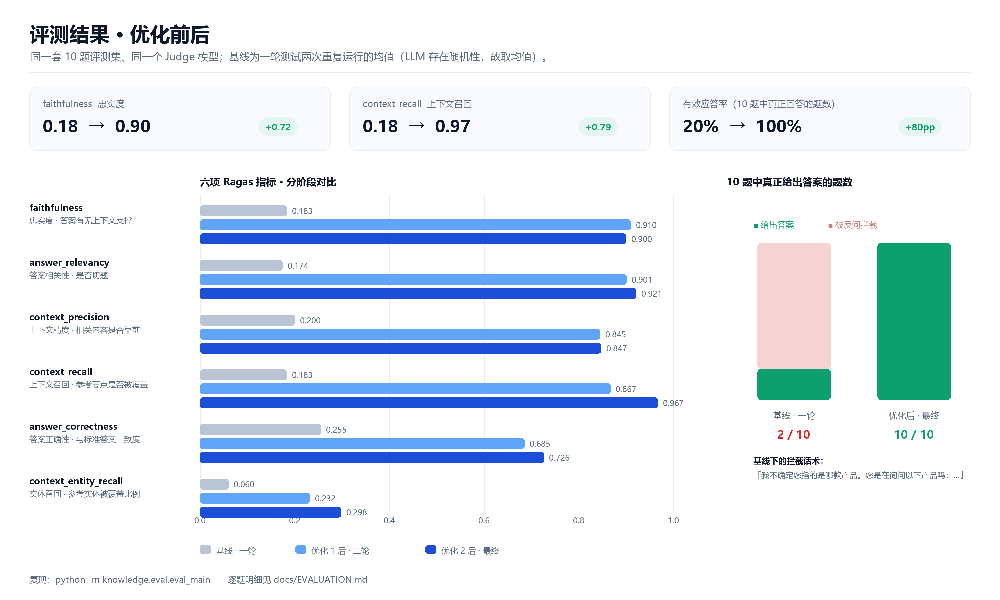
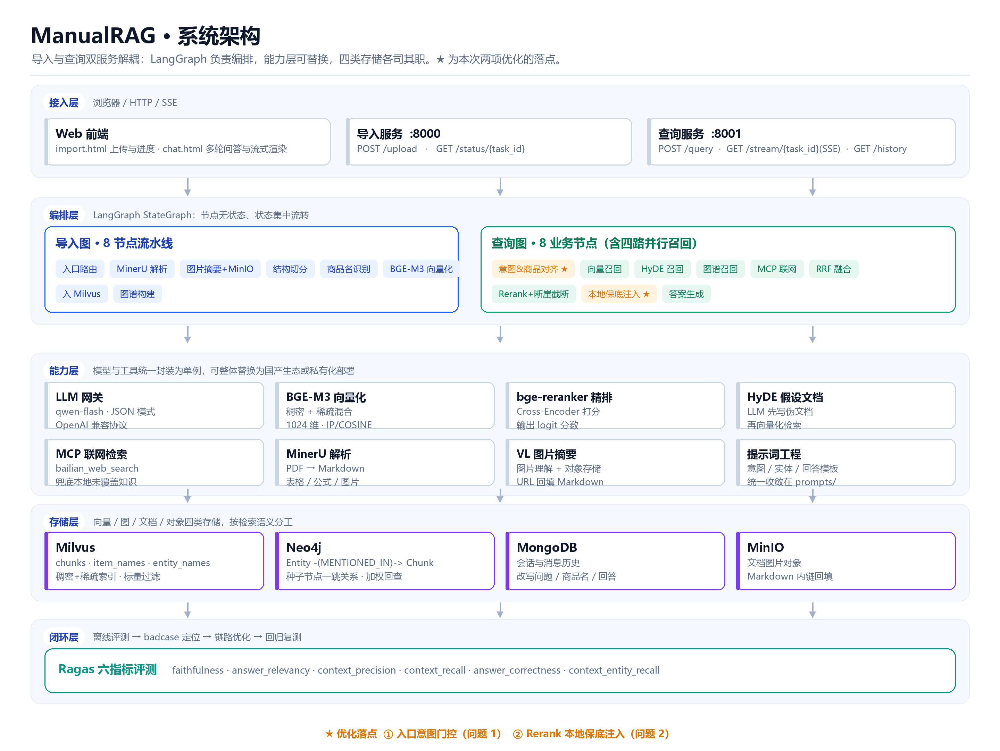
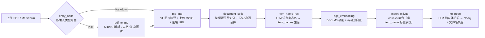
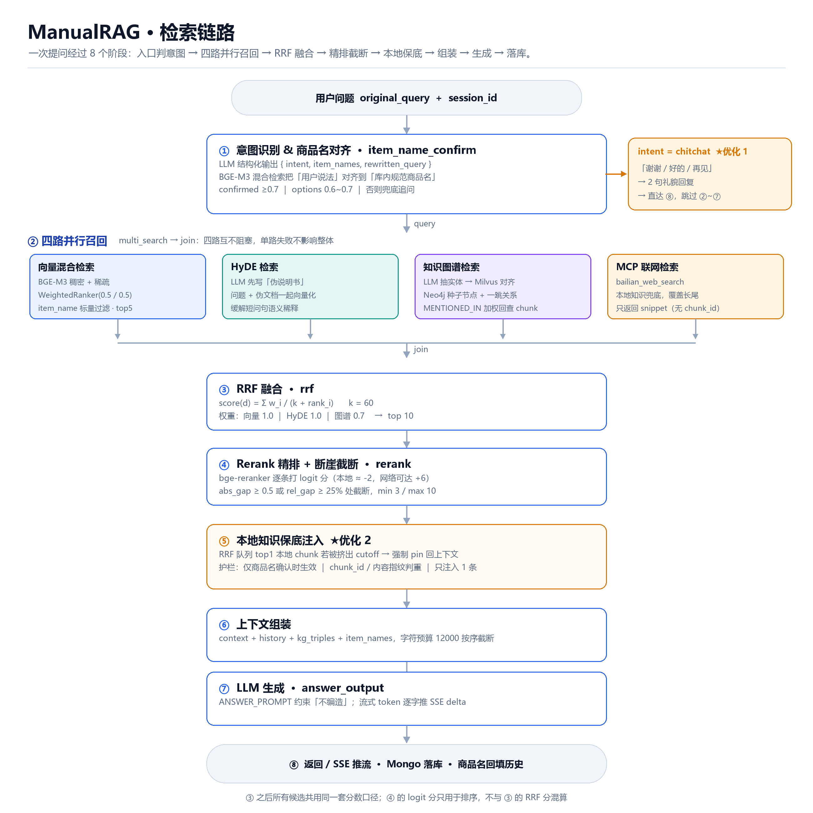
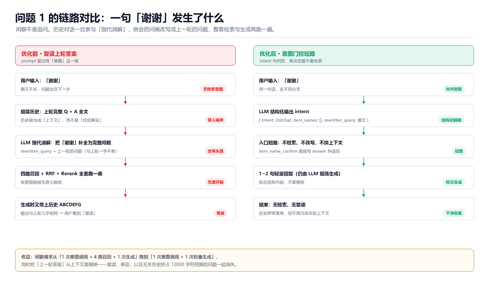
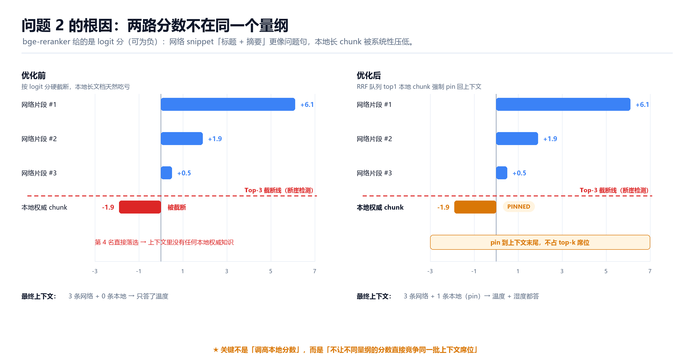
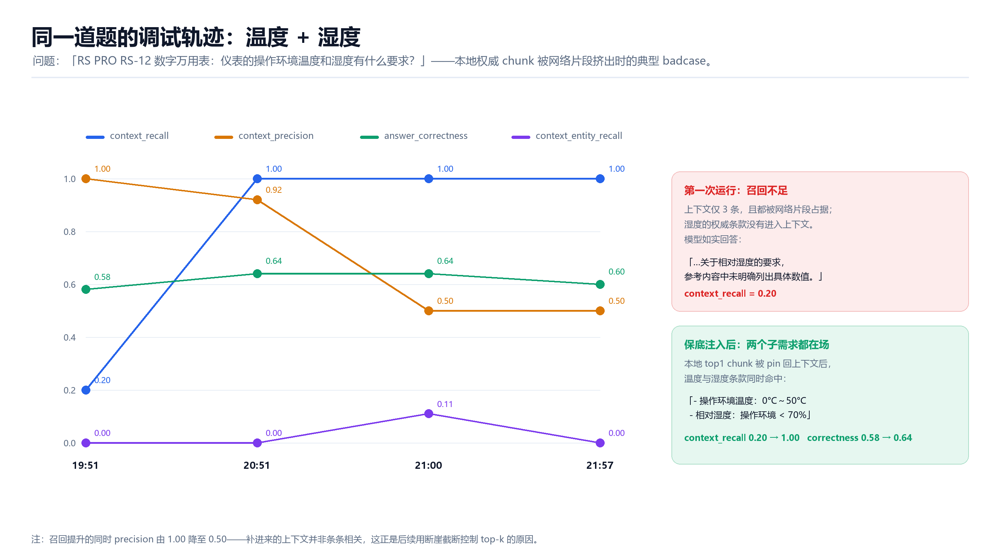

# ManualRAG 

> 把一摞商品说明书（PDF / 表格 / 图片）变成能被连续追问的私有知识库：四路并行召回 + RRF 融合 + 精排截断 + 意图门控 + 本地知识保底，配套 Ragas 六指标回归。


---

## 为什么值得看这个仓库

RAG 的 demo 很好写：`向量库 + 检索 + 拼 prompt`，一下午就能跑通。真正难的是**它开始出错的那些边角**：

- 用户说一句「谢谢」，系统把上一轮的问题和答案又复读了一遍；
- 一道题问了「操作温度和湿度」，检索只捞回温度，模型就老老实实答「湿度没找到」；
- 本地手册里明明写着答案，rerank 却把它排在网络摘要后面，因为一个是长文档、一个是短 snippet；
- 改了一版 prompt，感觉变好了，但**说不出好多少，也说不清是不是这次改动的功劳**。

这个仓库把上面四个问题逐条摊开：现象、根因、改法、指标。所有数字来自 `knowledge/eval/eval_output/` 下的真实运行记录，可复现。

### 一分钟看懂两处改动

| | 问题 | 触发场景 | 改动位置 | 手段 | 结果 |
| --- | --- | --- | --- | --- | --- |
| **优化 1** | 闲聊被当成追问，复读上轮答案 | 用户说「谢谢」「好的」 | `item_name_confirm_node.py` | LLM 输出增加 `intent`，`chitchat` 在入口短路 | 有效应答 2/10 → 10/10，faithfulness 0.18 → 0.91 |
| **优化 2** | 网络片段挤掉本地权威知识 | 问题含多个子需求（温度 + 湿度） | `rerank_node.py` | RRF top1 本地 chunk 被挤出时**保底注入** | 该题 context_recall 0.20 → 1.00，全量 0.87 → 0.97 |

---

## 效果速览

同一套 10 题评测集、同一个 Judge 模型、同一条真实链路（`query_app`，非 mock）：

| 指标 | 基线 | 优化后 | 变化 |
| --- | ---: | ---: | ---: |
| faithfulness（忠实度） | 0.183 | **0.900** | +0.72 |
| answer_relevancy（答案相关性） | 0.174 | **0.921** | +0.75 |
| context_precision（上下文精度） | 0.200 | **0.847** | +0.65 |
| context_recall（上下文召回） | 0.183 | **0.967** | +0.78 |
| answer_correctness（答案正确性） | 0.255 | **0.726** | +0.47 |
| context_entity_recall（实体召回） | 0.060 | **0.298** | +0.24 |
| **有效应答率** | 2 / 10 | **10 / 10** | +80pp |



> 基线那 0.18 不是「检索烂」，而是**入口判断错**：10 题里 8 题被反问「您是在询问以下产品吗」。指标全部停在 0.2 量级，是链路根本没启动的结果。这一点在做优化时非常重要——**先确认指标低是「哪一段」造成的**，否则会去调一个不需要调的东西。

---

## 系统架构



三句话概括：

1. **两个服务、两张图**。导入走 `:8000`（`POST /upload` → 后台跑导入图），查询走 `:8001`（`POST /query` / `GET /stream/{task_id}`）。服务之间不共享内存，只共享存储。
2. **编排在 LangGraph，能力在工具层**。节点只做「读 state → 调一个能力 → 写 state」，把 LLM、BGE-M3、reranker、MCP 都封装成单例工具，换模型只改一处。
3. **四类存储各管一段语义**。Milvus 管向量与商品名/实体名索引，Neo4j 管实体关系，MongoDB 管会话历史，MinIO 管图片对象。

<details>
<summary>入库链路（8 节点，点击展开 mermaid）</summary>



</details>

### 分层职责

| 层 | 组件 | 职责 |
| --- | --- | --- |
| 接入层 | `api/import_router.py`、`api/query_router.py` | FastAPI 路由、CORS、静态页挂载、SSE 长连接 |
| 编排层 | `processor/import_process/`、`processor/query_process/` | LangGraph 状态图；节点无状态，state 集中流转 |
| 能力层 | `utils/*` | LLM 网关、BGE-M3 向量化、bge-reranker、HyDE、MCP 联网、MinerU、VL 图片理解 |
| 存储层 | Milvus / Neo4j / MongoDB / MinIO | 向量、图、会话、对象 |
| 闭环层 | `eval/eval_main.py` | 真实链路跑 Ragas，逐题明细按时间戳归档 |

---

## 检索链路



| # | 节点 | 做什么 | 要注意的地方 |
| ---: | --- | --- | --- |
| ① | `item_name_confirm` | LLM 判 `intent` + 抽商品名 + 改写问题；再用 BGE-M3 混合检索把「用户说法」对齐到「库内规范名」 | 对齐阈值 0.7 / 0.6，直接决定这一轮是「答」还是「反问」 |
| ② | 四路并行召回 | 向量（稠密+稀疏）、HyDE、图谱、MCP 联网 | 四路互不阻塞，单路失败不影响整体 |
| ③ | `rrf` | `score = Σ wᵢ/(k+rankᵢ)`，k=60，权重 1.0 / 1.0 / 0.7 | 只融合带 `chunk_id` 的本地三路，网络结果不参与 |
| ④ | `rerank` | bge-reranker 逐条打 logit 分；断崖检测截断 | logit 分可为负，**与 RRF 分不可混算** |
| ⑤ | 本地保底注入 | RRF top1 本地 chunk 若被挤出，pin 回上下文 | 只 pin 1 条，见「优化 2」 |
| ⑥ | 组装 | context + history + kg_triples + item_names，预算 12000 字符 | 按顺序截断，先保上下文再保历史 |
| ⑦ | `answer_output` | LLM 生成（流式逐 token 推 SSE） | 提示词明确「不要编造」；图片只允许来自本地切片 |
| ⑧ | 落库 | Mongo 写 user / assistant，商品名回填历史 | 下一轮指代消解的原料 |

### 关键参数

| 参数 | 默认值 | 位置 |
| --- | ---: | --- |
| 商品名确认阈值 / 反问阈值 | 0.7 / 0.6 | `item_name_confirm_node.py` |
| 多候选分数差过滤 | 0.15 | 同上 |
| RRF k / 权重 / top | 60 / 1.0·1.0·0.7 / 10 | `config.py` + `rrf_node.py` |
| rerank min / max top-k | 3 / 10 | `config.py` |
| 断崖阈值（绝对 / 相对） | 0.5 / 25% | `config.py` |
| 上下文预算 | 12000 字符 | `MAX_CONTEXT_CHARS` |
| 保底注入条数 | 1（`rrf_chunks[0]`） | `rerank_node.py` |

---

## 优化 1：一句「谢谢」不该触发四路召回

### 现象

> 用户发「谢谢」，系统返回的却是**上一轮的提问 + 上一轮的回答**，一字不差地再念一遍。

排查时看到的中间产物：

```
历史记录：
用户: 谢谢
助手: 使用 RS PRO RS-12 数字万用表的负极 COM 端口和正极 V 端口测试 9V / 1.5V 电池……
      （上一轮那份 1000+ 字的长回答）

LLM 改写后的查询：
"关于 RS PRO RS-12 数字万用表，如何使用其负极 COM 端口和正极 V 端口测试 9V 和 1.5V 电池，并判断电池好坏？"
      ↑ 与上一轮的问题完全相同
```

于是后续链路照常执行：四路召回拿到结果 G，再把历史 ABCDEFG 一并塞给大模型，生成一份和上次几乎一样的回答。

### 根因：不是模型「幻觉」，是提示词没给它「不查」这个选项

1. **入口 prompt 只有两个任务**：提取商品名、改写问题。面对「谢谢」，它必须「尽力找出商品名」，而最省力的做法就是沿用历史。
2. **历史是无差别拼接的**：最近 10 条 user + assistant 全量进 prompt，上一轮那份长回答本身就在里面，模型很容易把它当参考答案复述。
3. **下游都以「有 rewritten_query 就干活」为前提**：检索、rerank、生成没有任何「跳过」的语义，图结构上没有岔路。

### 改法：先判意图，再决定要不要查

**第一步**，把意图变成结构化字段（`prompts/query/query_prompt.py`）：

```diff
- 请根据历史会话和当前问题，提取用户正在询问的商品名称（item_names）。
+ 请根据历史会话和当前问题，先判断用户意图（intent），再决定是否提取商品名。
+    - "query"：咨询商品信息、提问或追问，需要检索知识库回答。
+    - "chitchat"：闲聊、致谢、寒暄、道别（如"谢谢""好的""再见""不用了"），不需要检索。
+ 3. 当 intent 为 "chitchat" 时：
+    - item_names 必须返回空列表；
+    - rewritten_query 原样返回用户当前问题；
+    - 禁止从历史会话中提取商品名或脑补出历史问题。
```

**第二步**，解析层白名单兜底（非法值回退 `query`，保持旧行为，避免一次解析失败就改变链路语义）：

```python
raw_intent = parsed_llm_result.get('intent')
clean_intent = raw_intent if raw_intent in ("query", "chitchat") else "query"
```

**第三步**，入口短路——这是全部改动的关键，只有 6 行：

```python
# knowledge/processor/query_process/nodes/item_name_confirm_node.py
if intent == "chitchat":
    state['answer'] = self._generate_chitchat_reply(original_query, history_text)
    state["history"] = chat_history
    return state          # 不检索、不改写、不拼上下文，直接交给 answer_output
```

`answer_output` 本来就有「已有 answer 就直接返回」的分支，所以**图结构一行没改**，改的只是入口的判定逻辑。



### 效果

- 闲聊请求：从「1 次意图调用 + 4 路召回 + 1 次生成」降到「1 次意图调用 + 1 次轻量生成」，回复从 300+ 字的复读变成 1~2 句。
- 顺带暴露并修掉的一个更严重的问题：商品名对齐阈值过严，`RS-12 数字万用表` 与库内 `RS PRO RS-12 数字万用表` 落在 0.6~0.7 的「需要澄清」区间，**10 题里 8 题被反问，链路根本没启动**。加固对齐规则后有效应答率 2/10 → 10/10，faithfulness 0.18 → 0.91。

> 这两个现象看着无关，其实是同一个病：**入口把「该不该答」和「答什么」混在一个判断里**。把意图拆出来单独判，两个问题一起消失。

---

## 优化 2：本地知识 vs 网络知识，不是调权重能解决的

### 现象

> 问「RS PRO RS-12 数字万用表的操作环境温度和湿度有什么要求？」
> 检索到的上下文里有温度、没有湿度，模型的回答是：
> 「……关于相对湿度的要求，参考内容中未明确列出具体数值。」

但那次运行的 rerank 分数长这样：

| 候选 | 来源 | rerank 分 |
| --- | --- | ---: |
| 网络片段 #1 | MCP | **+6.1** |
| 网络片段 #2 | MCP | +1.9 |
| 网络片段 #3 | MCP | +0.5 |
| 本地权威 chunk（含湿度条款） | Milvus | **-1.9** |

`min_top_k=3`，本地那条直接出局。上下文里只剩网络片段，而网络片段**只覆盖了「温度」**——模型没有幻觉，它只是如实转述了「上下文里没有湿度」。

### 为什么「给本地知识加权重」不 work

第一反应是「本地更权威，乘个系数」。但问题不在权重，在**量纲**：

- MCP 回来的是「标题 + 摘要」这种短句，和问句字面重合度天然高，Cross-Encoder 给高分；
- 本地 chunk 是整节说明书（几百字），信息被稀释，logit 分常年为负；
- 6.1 与 -1.9 的差距**不是相关性差距，是文本形态差距**。

给本地乘系数就得先做跨源归一化，而「本地一定比网络好」这个先验在长尾问题上经常是错的（网络片段确实可能更贴题）。**用一个新偏差去修一个偏差，不划算。**

### 改法：不动分数，改「席位规则」

在 rerank 之后加一步：本地融合最高分的那条 chunk，如果被截断挤出去了，就**强制占一个上下文席位**。

```python
# knowledge/processor/query_process/nodes/rerank_node.py（简化）
def process(self, state):
    ...
    cutoff_docs = self._cliff_cutoff(reranked_docs)          # ④ 断崖截断
    final_docs = self._inject_local_topk(cutoff_docs, state)  # ⑤ 本地保底
    state['reranked_docs'] = final_docs
```

三条护栏，防止「保底」变成「塞噪声」：

1. **只在本轮商品名已确认时生效**（`state['item_names']` 非空）——名字都没对齐，本地知识可信度无从谈起；
2. **判重**：优先比 `chunk_id`，回退比内容前 100 字指纹，已被 rerank 保留就跳过；
3. **只注入 1 条**：取 `rrf_chunks[0]`，不为凑 k 条去补次优本地 chunk。

注入的文档带 `pinned: True` 标记，会一路带到评测明细里，方便事后审计「这条到底该不该在上下文里」。



### 效果

| 视角 | 改前 | 改后 |
| --- | ---: | ---: |
| 温度 + 湿度单题 · context_recall | 0.20 | **1.00** |
| 温度 + 湿度单题 · 回答 | 「湿度未找到」 | 温度 0~50°C + 湿度 < 70% 都给 |
| 全量 10 题 · context_recall | 0.867 | **0.967** |
| 全量 10 题 · answer_correctness | 0.685 | **0.726** |
| 全量 10 题 · context_precision | 0.845 | 0.847（未下降） |
| 全量第 10 题（就是这道） · context_recall | 0.000 | **1.000** |

`context_precision` 几乎没动，是这次改动最想要的结果：**召回涨了，噪声没涨**。



> 图里 precision 从 1.00 掉到 0.50 的那一段，正是「补上下文」的代价：补进来的 chunk 并非条条相关。这也是后来把 `max_top_k` 收紧、只 pin 1 条的原因——**召回保底，精度靠截断**。

---

## 评测：先有尺子，再谈优化

### 设计

| 项 | 做法 |
| --- | --- |
| 框架 | Ragas（LLM-as-judge） |
| 数据集 | 10 题商品 QA（question / ground_truth），单商品领域 |
| 被测对象 | 真实链路 `query_app.invoke()`，检索上下文取 `state.reranked_docs`（即 rerank + 截断 + 保底之后） |
| Judge / Embedding | 复用项目 `qwen-flash` 与 BGE-M3（自己写了 `BaseRagasEmbeddings` 适配器，只取 dense 向量） |
| 归档 | 每次运行落 `eval_scores_*.csv`（逐题指标）+ `eval_details_*.csv`（逐题问答与上下文），按时间戳分目录 |

三轮全量结果：

| 阶段 | faithfulness | answer_relevancy | context_precision | context_recall | answer_correctness | 有效应答 |
| --- | ---: | ---: | ---: | ---: | ---: | ---: |
| 基线 · 一轮测试 | 0.183 | 0.174 | 0.200 | 0.183 | 0.255 | 2 / 10 |
| 优化 1 后 · 二轮测试 | 0.910 | 0.901 | 0.845 | 0.867 | 0.685 | 10 / 10 |
| 优化 2 后 · 最终 | 0.900 | 0.921 | 0.847 | **0.967** | **0.726** | 10 / 10 |

逐题明细、单题轨迹、复现命令都在 **[docs/EVALUATION.md](docs/EVALUATION.md)**。

### 这份数据的边界（写在前面，免得被误读）

- **10 题、单商品**：只适合做「改前改后」的相对比较，不适合当能力宣称。
- **Judge 有方差**：同一份数据重跑会有 ±0.02~0.05 的抖动。所以第一轮跑了两遍取均值；优化 1 到优化 2 之间 faithfulness 从 0.910 掉到 0.900，这个量级**不足以说明变差**。
- **`context_entity_recall` 在中文场景参考价值有限**：它对中文型号、单位（如 `%RH`、`RS-12`）的抽取不稳定，长期为 0 更多反映 judge 抽不出实体，而不是上下文真缺实体。它在 0.06 → 0.30 的变化可以参考，绝对值别当真。
- **单题 n=1**：第 4 节那张轨迹图是同一道题跑 4 次，用来定位问题，不做统计推断。

---

## 快速开始

### 依赖

| 组件 | 用途 | 备注 |
| --- | --- | --- |
| Milvus 2.4+ | 向量库（稠密 + 稀疏） | 三个集合：chunks / item_names / entity_names |
| Neo4j 5.x | 知识图谱 | `Entity -(MENTIONED_IN)-> Chunk` |
| MongoDB | 会话历史 | 也可以换任意 KV，改 `mongo_history_util.py` |
| MinIO | 图片对象存储 | 存储切出来的文档图片 |
| DashScope API | LLM（qwen-flash） | OpenAI 兼容协议 |
| MinerU | PDF → Markdown | 建议 `uv pip install -U "mineru[all]"` |
| BGE-M3 / bge-reranker | 本地向量化与精排 | 首次运行会自动下载，可指定本地路径 |

```bash
pip install -r knowledge/requirements.txt
```

### 环境变量

```bash
# ---- LLM ----
OPENAI_API_KEY=sk-****                     # 只从环境变量读，不要写进代码
OPENAI_API_BASE=https://dashscope.aliyuncs.com/compatible-mode/v1
ITEM_MODEL=qwen-flash
VL_MODEL=qwen-vl-max

# ---- Milvus ----
MILVUS_URL=http://127.0.0.1:19530
CHUNKS_COLLECTION=kb_chunks
ITEM_NAME_COLLECTION=kb_item_names
ENTITY_NAME_COLLECTION=kb_entity_names

# ---- Neo4j ----
NEO4J_URI=bolt://127.0.0.1:7687
NEO4J_USERNAME=neo4j
NEO4J_PASSWORD=****
NEO4J_DATABASE=neo4j

# ---- MongoDB ----
MONGO_URL=mongodb://127.0.0.1:27017
MONGO_DB_NAME=shopkeeper_brain

# ---- MinIO ----
MINIO_ENDPOINT=127.0.0.1:9000
MINIO_ACCESS_KEY=****
MINIO_SECRET_KEY=****
MINIO_BUCKET_NAME=knowledge-base

# ---- 本地模型 ----
BGE_M3_PATH=BAAI/bge-m3
BGE_DEVICE=cpu
BGE_RERANKER_LARGE=BAAI/bge-reranker-v2-m3
BGE_RERANKER_DEVICE=cpu

# ---- MCP 联网检索（必填：留空会让联网召回节点直接报错）----
MCP_DASHSCOPE_BASE_URL=https://dashscope.aliyuncs.com/api/v1/mcps/...
```

### 启动

```bash
# 导入服务（上传 + 解析 + 向量化 + 建图）
python -m knowledge.api.import_router          # :8000  →  http://localhost:8000/import

# 查询服务（检索 + 生成 + 流式）
python -m knowledge.api.query_router           # :8001  →  http://localhost:8001/chat.html
```

### 走一遍

```bash
# 1) 导入一份说明书（PDF / Markdown 均可）
curl -F "file=@万用表的使用.pdf" http://localhost:8000/upload
# → {"message":"文件上传成功","task_id":"..."}

# 2) 轮询进度
curl http://localhost:8000/status/<task_id>

# 3) 提问
curl -X POST http://localhost:8001/query \
     -H "Content-Type: application/json" \
     -d '{"query":"RS PRO RS-12 数字万用表怎么测 1.5V 电池？","is_stream":false}'
```

> 想直接看链路中间产物（四路召回各自几条、RRF 分数区间、rerank 截断位置），把对应节点 `__main__` 里的 mock 跑一遍即可，每个节点都自带可执行的示例。

---

## 项目结构

```
shopkeeper_brain/
├── README.md
├── docs/
│   ├── EVALUATION.md              # 评测明细（脚本生成）
│   └── assets/                    # README 用图
├── scripts/
│   └── make_eval_report.py        # 从 eval_output 重新生成 EVALUATION.md
└── knowledge/
    ├── api/                       # FastAPI 路由（导入 :8000 / 查询 :8001）
    ├── processor/
    │   ├── import_process/        # 导入图：8 节点
    │   │   └── nodes/             # pdf_to_md / md_img / document_split / ...
    │   └── query_process/         # 查询图：8 业务节点
    │       ├── main_graph.py      # 图拓扑（并行分流 + 汇合）
    │       ├── config.py          # 全部阈值集中在此，支持环境变量覆盖
    │       └── nodes/             # item_name_confirm / vector / hyde / kg / mcp / rrf / rerank / answer
    ├── prompts/                   # 提示词模板（意图、实体、HyDE、回答）
    ├── schema/                    # Pydantic 请求/响应模型
    ├── services/                  # 业务编排（上传、任务、查询）
    ├── utils/                     # LLM / BGE-M3 / reranker / Milvus / Neo4j / Mongo / MinIO / SSE
    └── eval/                      # Ragas 评测 + 历史运行记录
```

---

## 技术栈

| 类别 | 选型 | 为什么 |
| --- | --- | --- |
| Web | FastAPI + Uvicorn | 原生 async，SSE 长连接好写 |
| 编排 | LangGraph | 并行分流、条件边、状态集中，链路可画出来 |
| 向量库 | Milvus | 稠密 + 稀疏混合检索、标量过滤（按商品名限定召回范围） |
| 向量模型 | BGE-M3 | 一次编码同时给 dense 与 sparse，省一次模型加载 |
| 精排 | bge-reranker-v2-m3 | Cross-Encoder 精度明显高于双塔 |
| 图谱 | Neo4j | 一跳关系 + chunk 反查，补上「多跳」这一路 |
| 文档解析 | MinerU | 表格、公式、图片版式保留得比较完整 |
| LLM | qwen-flash（DashScope） | 便宜、够用，JSON 模式稳定 |
| 评测 | Ragas | 六指标开箱即用，逐题明细方便定位 badcase |

---

## Roadmap / 已知局限

**正在做**

- [ ] 覆盖度自检节点（`coverage_check_node.py`）已实现「把问题拆子需求 → 逐条核对 → 定向补 chunk」，但还没接进主图，提示词模板与两个配置项（`coverage_max_iterations` / `coverage_supplement_per_source`）待补。这是优化 2 的「通用版」：现在只保底本地 top1，之后按**缺失的子需求**去补，而不是按分数补。
- [ ] 商品名对齐阈值（0.7 / 0.6）目前是经验值，想用一批真实问法做标定。
- [ ] RRF 权重固定 1.0 / 1.0 / 0.7，考虑按查询类型（参数型 / 操作型 / 故障排查型）动态调整。

**已知局限**

- 只支持单商品域内的多轮对话，跨商品对比类问题还没做聚合。
- MCP 联网结果没有 `chunk_id`，无法参与 RRF，只能整体进 rerank，融合得比较粗。
- 没有并发压测数据。reranker 跑在 CPU 上，是当前链路的延迟大头。
- 会话历史按条数截断（最近 10 条），没有按 token 预算做滑动窗口。
- 商品名集合名在 item_name_confirm_node.py 里写死为 kb_item_names_v2，与 config.ITEM_NAME_COLLECTION 还没打通，待统一。

---

## 安全提醒

- **不要把 API Key 写进代码默认值**。请确认 `knowledge/utils/llm_client_util.py` 只从环境变量读取密钥，并检查 `.gitignore` 是否已忽略 `.env`。
- 上传的文档会经 MinerU / VL 模型处理，生产环境建议加文件类型与大小校验、以及租户隔离。
- 本项目按 MIT 协议开源，模型权重与三方服务（DashScope / Milvus / Neo4j）遵循各自的许可与计费规则。

## License

[MIT](LICENSE) · 欢迎 issue / PR。如果这个仓库里的某个排查过程对你有用，点个 star 就好。
